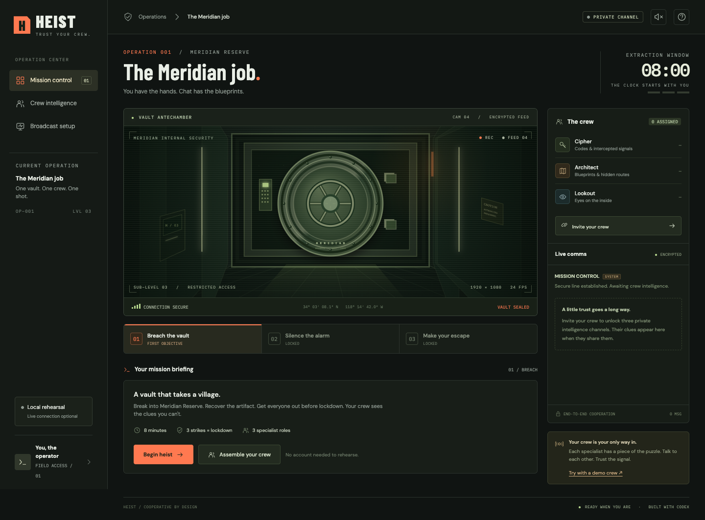

# HEIST

**The streamer has the controls. Chat has the blueprints.**

HEIST is an asymmetric cooperative escape room for Twitch. The streamer faces a vault and a countdown. Viewers become the Cipher, Architect, or Lookout, each holding a different piece of the solution. The crew must combine its clues and communicate before the streamer commits to an action.



Three linked stages turn the stream into a shared mission:

1. **Outer lock:** reconstruct a four-digit access code from split intelligence.
2. **Alarm circuit:** identify and cut the correct wire.
3. **Escape route:** choose the exit that gets the crew out alive.

Three mistakes or an expired clock end the mission. The server owns the clock, puzzle answers, and state transitions; the host and public overlay never receive private dossiers in their state responses. Browser crew members receive only their assigned role's current dossier. Deliberately sharing clues in chat is the cooperation mechanic.

## Run locally

Requires **Node.js 24 or newer**. There are no runtime package dependencies and no build step.

```sh
npm start
```

Open [http://localhost:3000](http://localhost:3000), create a mission, and share the crew link. Use separate browsers or independent browser profiles to try different roles. Tabs and private windows that share storage may reuse the same crew session. Use the host's explicit demo crew controls to rehearse alone; demo messages are labeled and are not live Twitch activity.

```sh
npm test
```

`npm run check` validates the JavaScript sources. The automated suite covers the game rules, 100 seeded full heists, private state projections, API access controls, live updates, and the Twitch protocol with mocked Twitch services. The optional `test/browser-smoke.mjs` exercises a complete game with three independent real-browser crew sessions, mobile views, and the OBS overlay. It requires Playwright and a compatible Chromium browser; its header documents the environment variables. Screenshots and the browser report are written to the ignored `artifacts/browser/` directory.

All fonts and camera graphics are bundled or drawn locally. The rehearsal and browser crew experience work without an external service.

## Views

| Route | Purpose |
| --- | --- |
| `/` | Mission briefing and room creation |
| `/play/ROOM` | Streamer controls, countdown, vault, and communications |
| `/crew/ROOM` | Join the crew, read a private dossier, share clues and votes |
| `/overlay/ROOM` | Read-only broadcast view without private dossiers |
| `/api/health` | Server health check |

The host browser retains a room-specific control token. Crew sessions retain their own participant token. Treat a host link containing a token as a control credential; share the crew link with viewers instead. Rooms and sessions are held in memory and are lost when the server restarts.

## Connect your Twitch channel

The local game works without a Twitch account. The optional bridge connects to the broadcaster's **own channel** using Twitch's installed-chatbot model. It is not a multi-tenant cloud bot service.

1. [Register an application with Twitch](https://dev.twitch.tv/docs/authentication/register-app/) and note its client ID.
2. Obtain a **user access token for the broadcaster**, issued for that same client ID, with `user:read:chat`. Add `user:write:chat` if you want command replies sent to Twitch chat. For local testing, register `http://localhost:3000` as the OAuth redirect, run `twitch configure` with the application's client ID and secret, then `twitch token --user-token --scopes "user:read:chat user:write:chat"`. **Generate the token before starting HEIST:** the CLI callback also uses port 3000. HEIST itself needs the client ID and user access token, not the client secret or refresh token.
3. Copy `.env.example` to `.env` and set `TWITCH_CLIENT_ID` and `TWITCH_ACCESS_TOKEN`. Keep `.env` private. Restart the server after changing environment settings.
4. Create a room and use the host's Twitch connection control. A configured token alone does not mean the bridge is connected; check the connection status.
5. In your channel's chat, try `!heist`, `!clue`, and `!vote OPTION`. Use an option ID displayed by the current puzzle, such as a wire or exit ID. During the lock stage, a four-digit code is also a valid vote. Votes advise the streamer; they do not submit or solve a puzzle. Twitch chat identities and browser crew sessions are separate; select your chat-assigned role when joining in the browser if you want matching clues.

The bridge validates the token, identifies its owner, and subscribes to `channel.chat.message` using EventSub WebSockets. The broadcaster and reading user are the same account. API credentials stay on the server. Tokens must be replaced when expired or revoked; this starter does not provide an OAuth onboarding and refresh-token service.

Twitch reference: [installed chatbot authentication and scopes](https://dev.twitch.tv/docs/chat/authenticating/), [EventSub WebSocket lifecycle](https://dev.twitch.tv/docs/eventsub/handling-websocket-events/), and [access token validation](https://dev.twitch.tv/docs/authentication/validate-tokens/).

Follow [the real-channel and OBS verification runbook](docs/LIVE-TEST.md) for expected results, evidence boundaries, and current limitations. The bridge has been tested with mocked Twitch services; a real channel has not been verified.

## Broadcast with OBS

Add a **Browser Source** pointing at `http://localhost:3000/overlay/ROOM`, replacing `ROOM` with your room code. Start with a 1920 × 1080 source and fit it to the scene. Keep the crew's private dossier windows off stream. The overlay is read-only and does not require the host control token.

The host view can also be captured when you want the interactive controls visible. Test the complete scene before going live, including readability at your stream resolution.

The overlay is a HUD containing the timer, objectives, crew count, strikes, and result; use a capture of the operator browser window to show the vault, puzzle controls, and chat feed. The overlay has been checked in Chrome, not inside OBS or a live broadcast.

## Viewers on other devices

`localhost` works only on the machine running the server. For a trusted local network, start with `HOST=0.0.0.0 npm start`, then share a crew URL using the server machine's LAN address. Allow the chosen port through the local firewall if necessary.

Remote internet viewers need a reachable HTTPS deployment or an HTTPS tunnel that supports long-lived server-sent events. Set `PUBLIC_ORIGIN` to the exact external origin when using a proxy, and confirm that viewer links use that origin. This repository does not include a public deployment, durable rooms, distributed coordination, or a hosted account system. Public hosting needs appropriate connection limits, monitoring, and a persistent strategy if rooms must survive restarts.

## Docker

```sh
docker build -t heist .
docker run --rm -p 3000:3000 heist
```

To enable Twitch, pass an environment file with `--env-file .env`. The container listens on all interfaces internally. Do not publish credentials into an image or the repository.

## Project layout

```text
Twitch/
├── public/              Browser interface and original visual assets
├── lib/engine.mjs       Authoritative puzzles, roles, clock, and game rules
├── lib/twitch.mjs       Optional Twitch EventSub chat bridge
├── server.mjs           HTTP API, room sessions, and real-time state
├── test/                Engine and server checks
├── docs/DEMO.md         Under-three-minute recording plan
├── docs/DEVPOST.md      Submission text and evidence checklist
├── docs/CONTRACT.md     Implementation interface
├── .env.example         Optional local Twitch configuration
└── Dockerfile
```

## Submission status

This is source code and local demo tooling. A Twitch broadcast, public repository, hosted URL, recorded demo, and Devpost submission must each be verified separately. See [the demo plan](docs/DEMO.md) and [submission draft](docs/DEVPOST.md). Record the actual Codex session ID from the build chat's `/status` output before submitting.

MIT licensed. HEIST is an independent project; Twitch and OpenAI are referenced as integration and development platforms.
